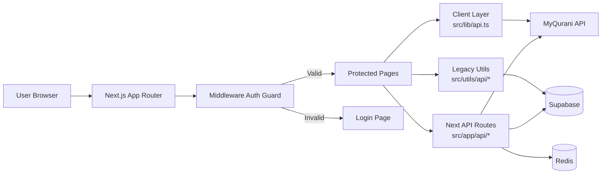
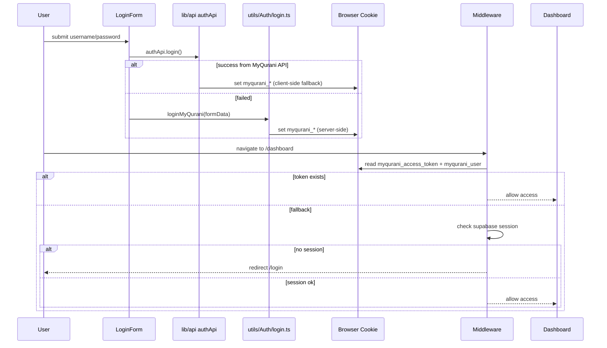
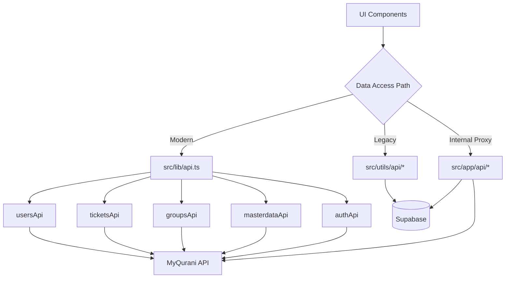
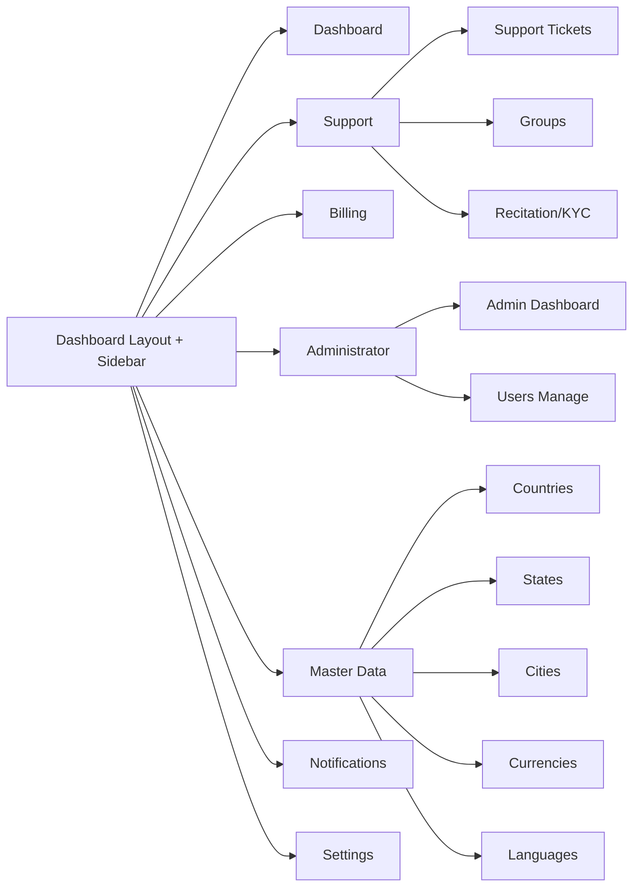

# Diagram Arsitektur `admin-qurani-org`

Dokumen ini berisi diagram alur utama project dalam format Mermaid.

## 1) High-Level Architecture



---

## 2) Auth Flow (Current Hybrid)



---

## 3) Data Source Mapping



---

## 4) Module Navigation Map



---

## 5) Ticket Flow (Hybrid Runtime)

```mermaid
flowchart TD
    UI[SupportTicketsPage] --> L1[ticketsApi.getTickets()]
    L1 --> MQ[MyQurani API]

    UI --> L2[/api/tickets/supabase/list]
    L2 --> SB[(Supabase tickets)]

    MQ --> Merge[Merge & Normalize Data]
    SB --> Merge
    Merge --> UI2[Render Table/Card + Filters]
```

---

## 6) Group Flow (Mixed)

```mermaid
flowchart TD
    G1[Group Pages] --> H1[use-grup-data.ts]
    H1 --> H2[MyQurani Groups Search API]

    G1 --> H3[use-group-members.ts]
    H3 --> H4[/api/grup?action=getGroupMembers]
    H4 --> SB[(Supabase grup_members)]

    G1 --> H5[Member Mutation]
    H5 --> H6[/api/grup POST action=*]
    H6 --> SB
```

---

## 7) Catatan Interpretasi Diagram

1. Jalur tebal modern: `src/lib/api.ts` -> MyQurani API.
2. Jalur legacy penting: `src/utils/api/*` dan `/api/grup` masih banyak ke Supabase.
3. Middleware adalah gerbang utama auth route.
4. Bug yang paling sering: sinkronisasi token/cookie + perbedaan sumber data antar modul.
